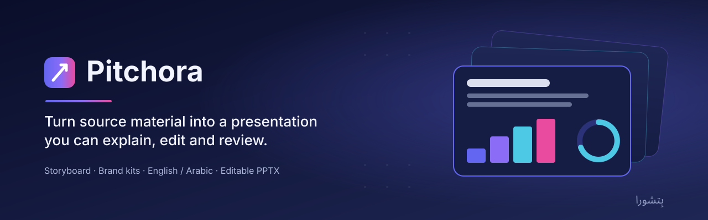
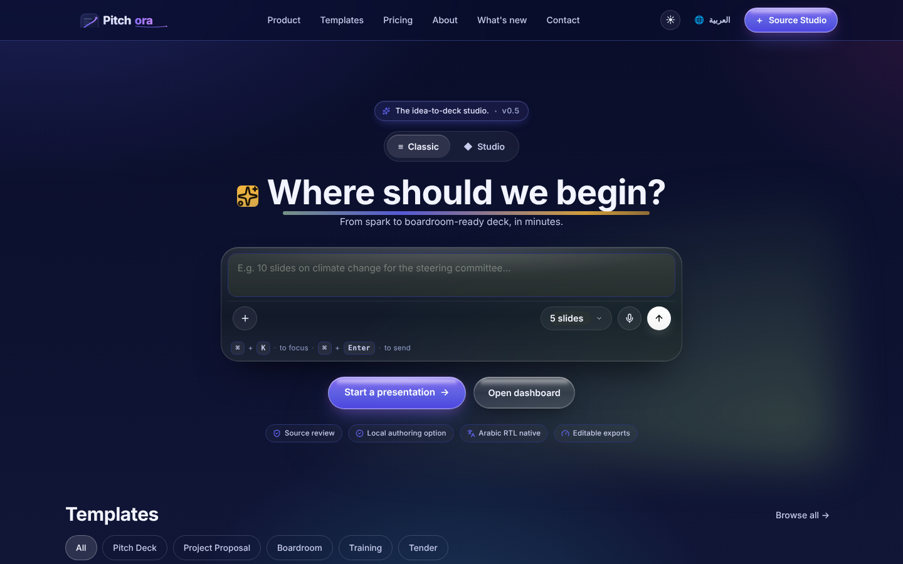
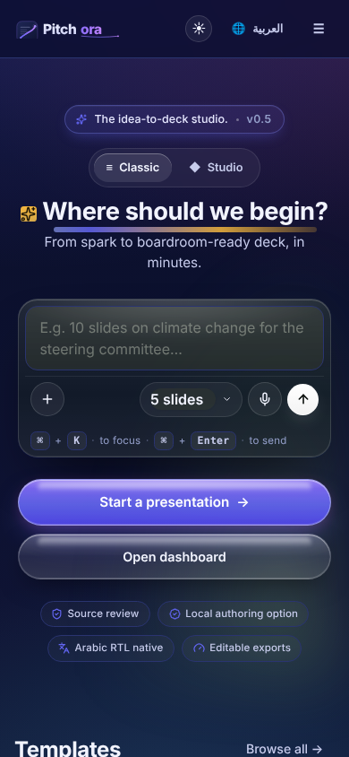
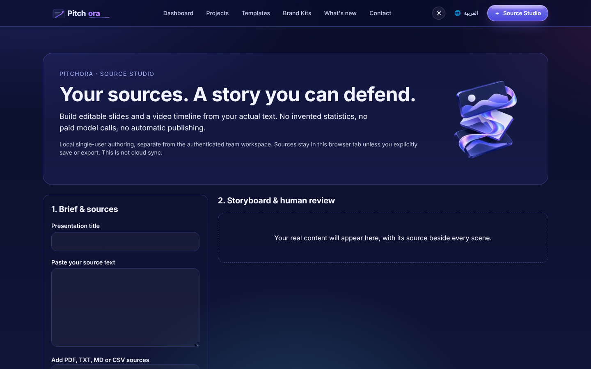
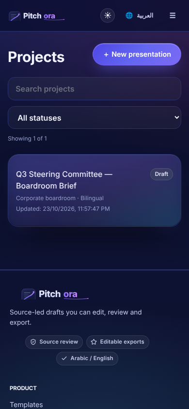
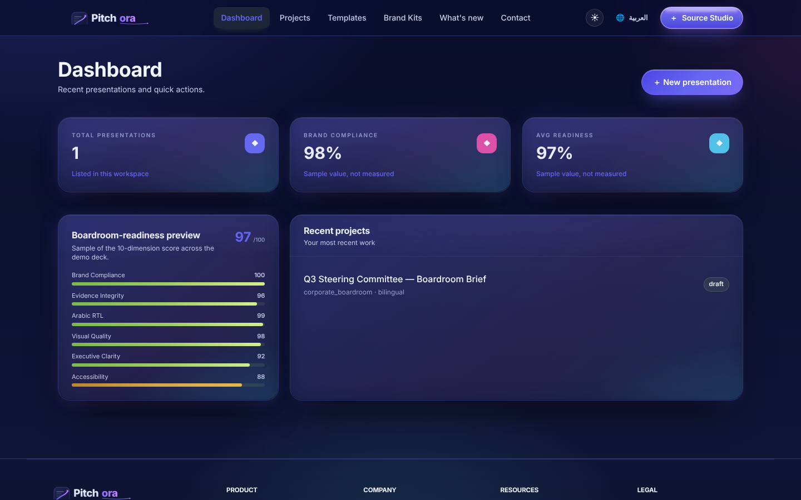
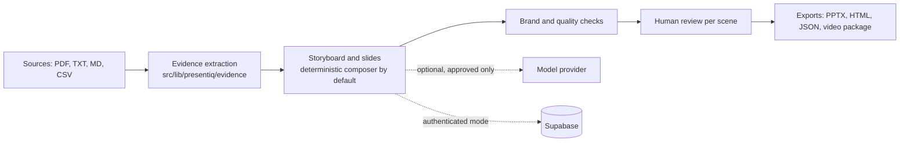

<p align="center">
  
</p>

# Pitchora

**Turn source material into a presentation you can explain, edit and review.**

<p align="center"><br><sub><em>Concept image (AI-generated). Not a product screenshot.</em></sub></p>


[Overview](#overview) · [Features](#key-features) · [Screenshots](#screenshots) ·
[Quick start](#quick-start) · [Deploy](#deploy-on-vercel) · [Status](#status-and-known-limitations) ·
[العربية](#بالعربية)

## Overview

Pitchora brings storyboarding, brand kits, bilingual slide composition and
editable PowerPoint export into one workspace. It is for people preparing a
board, committee or client presentation who need to inspect what supports the
story, not just produce attractive slides.

**Source material → Storyboard → Slides → Brand and evidence review → Editable export**

The presentation application lives at `/presentiq`. The source also retains
inherited learning routes and client packages (`desktop/`, `mobile/`,
`extension/`). They are preserved, not reclassified as verified Pitchora
features. See [product boundaries](docs/PRODUCT_AUTHORITY.md).

### Repository identity

This is `ahmadzayan-hub/Pitchora-studio`. A similarly named repository,
`ahmadzayan-hub/pitchorastudio`, shares much of this code but has a separate
history and has diverged (it lacks Source Studio and its delivery workflow).
[docs/SOURCE_STUDIO.md](docs/SOURCE_STUDIO.md) records this repository as the
canonical source and notes that the existing `pitchorastudio.vercel.app` alias
points to the sibling repository, not to this code. The
[repository guide](docs/REPOSITORY_GUIDE.md) asks that neither repository be
merged, archived, renamed or rerouted without an explicit decision.

## Key features

| Your task | What the code provides | Important boundary |
| --- | --- | --- |
| Author from your own sources | **Source Studio** at `/presentiq/source-studio`: import text PDF, TXT, Markdown or CSV in the browser, inspect page-linked excerpts, edit a storyboard and review each scene | Local single-user workflow. No model calls, no cloud sync |
| Hand off an editable deck | Editable PPTX, standalone HTML / print-to-PDF, JSON backup and a local video render package | Export is blocked until every scene is reviewed. The ZIP is not a video |
| Shape a presentation | Project wizard, narrative blueprint and slide editor | Generated content still needs a presenter's review |
| Keep a consistent identity | Brand kits, theme tokens and template tooling | Brand checks are not organizational approval |
| Inspect support for a claim | Evidence references, quality checks and review surfaces | A citation does not establish that a claim is true |
| Work in two languages | English / Arabic interface, composition and RTL handling | Review wording and exported layout in both languages |
| Find a project quickly | Projects page with text search, status filter and a mobile card layout | Filters run on the list already loaded in the page |

Source Studio limits, licenses and acceptance evidence are documented in
[docs/SOURCE_STUDIO.md](docs/SOURCE_STUDIO.md).

## Screenshots

Captured from a local production build (`npm run build && npm run start`) in
sample-data mode. The project and quality values shown are sample data.

| Desktop (1440 x 900) | Mobile (390 x 844) |
| --- | --- |
|  |  |
|  |  |
|  | |

## Quick start

Requires Node.js 22 (the version used by CI) and npm.

```bash
git clone https://github.com/ahmadzayan-hub/Pitchora-studio.git
cd Pitchora-studio
npm ci
cp .env.example .env.local
npm run dev
```

Open **http://localhost:3000/presentiq**. With the example file,
`NEXT_PUBLIC_DEMO_MODE=true`, so the app serves deterministic sample data and
skips Supabase, model providers and Stripe. Source Studio works without any
backend.

For an authenticated installation, configure a dedicated development backend
first and follow the [setup and release guide](docs/REPOSITORY_GUIDE.md):

- Set `NEXT_PUBLIC_DEMO_MODE=false`. Changing this flag alone does not connect a backend.
- Supply the Supabase URL and public key. Keep the service-role key on the server only.
- Verify the complete schema on an isolated database. Follow the
  [schema coexistence review](docs/schema-coexistence-release-review.md) and the
  [tenant enrollment review](docs/tenant-enrollment-release-review.md).
- Presentation generation defaults to free deterministic source extraction, even
  when a model key exists. A model provider is used only when explicitly selected
  by an approved caller.
- Missing payment configuration is not permission to use live payments for a smoke test.

## Scripts

| Command | What it does |
| --- | --- |
| `npm run dev` | Start the Next.js development server |
| `npm run build` | Production build |
| `npm run start` | Serve the production build |
| `npm run lint` | ESLint (`next lint`) |
| `npm run typecheck` | TypeScript check (`tsc --noEmit`) |
| `npm test` | Unit and integration tests (Vitest) |
| `npm run generate:icons` | Regenerate app icons |

Browser tests for Source Studio live in `e2e/` and run with
`npx playwright test` against a production build. Database checks need an
isolated PostgreSQL installation:

```bash
python3 scripts/test-tenant-rls.py --pg-bin /path/to/postgresql/bin --full-chain --concurrent
```

Never point the database test at production.

## Project structure

```text
src/
  app/presentiq/          presentation pages, editor and Source Studio
  app/api/presentiq/      presentation API routes
  lib/presentiq/          story, evidence, brand, model, PPTX and i18n logic
  components/presentiq/   presentation components
supabase/                 migrations, seed and SQL tests
e2e/                      Playwright browser tests
scripts/                  CI, database and renderer checks
docs/                     product, architecture, release reviews, assets
desktop/ mobile/ extension/   inherited client packages
```

## Architecture



| Area | Source |
| --- | --- |
| Presentation pages and editor | `src/app/presentiq/` |
| Presentation API | `src/app/api/presentiq/` |
| Story, evidence, brand, model and rendering logic | `src/lib/presentiq/` |
| Presentation components | `src/components/presentiq/` |
| Schema and isolated database regressions | `supabase/`, `scripts/test-tenant-rls.py` |
| Product and design specifications | `docs/presentiq/` |

The shared profile and learning schema is an integration boundary. Recent repairs
preserve existing records, prevent normal profile writes from assigning
privileged roles and restrict client-side subscription changes. They do not
certify historical data or assign new owners.

## Deploy on Vercel

`vercel.json` is committed and sets the build. Use these project settings:

| Setting | Value |
| --- | --- |
| Framework preset | Next.js |
| Root directory | `./` (repository root) |
| Install command | `npm ci` |
| Build command | `npm run build` |
| Output directory | `.next` |
| Node.js version | 22.x |
| Region | `fra1` (from `vercel.json`) |

Environment variables (see [.env.example](.env.example)):

| Variable | Needed for |
| --- | --- |
| `NEXT_PUBLIC_APP_URL` | Public HTTPS URL of the deployment |
| `NEXT_PUBLIC_DEMO_MODE` | `true` for previews with sample data. Never `true` in production |
| `NEXT_PUBLIC_SUPABASE_URL`, `NEXT_PUBLIC_SUPABASE_ANON_KEY` | Authenticated mode |
| `SUPABASE_SERVICE_ROLE_KEY` | Server-only admin routes. They return HTTP 503 when it is missing |
| `AI_PROVIDER`, `ANTHROPIC_API_KEY`, `ANTHROPIC_MODEL`, `OPENAI_API_KEY`, `OLLAMA_BASE_URL` | Optional model provider. Default composition stays extractive |
| `STRIPE_SECRET_KEY`, `STRIPE_WEBHOOK_SECRET`, `NEXT_PUBLIC_STRIPE_PUBLISHABLE_KEY`, `STRIPE_PRICE_*` | Optional billing. Billing returns HTTP 503 when unset |
| `EMAIL_FROM`, `RESEND_API_KEY` | Optional email |

The production build succeeds with no environment variables set. Missing
services degrade to sample data or HTTP 503 responses rather than failing the
build. Choosing which Vercel project and domain serve this repository is an
open decision recorded in [docs/SOURCE_STUDIO.md](docs/SOURCE_STUDIO.md).
Older notes in `DEPLOY.md` contain inherited assumptions; do not use them to
delete projects or move domains.

## Status and known limitations

Local verification on this branch: typecheck clean, lint clean (two existing
warnings), **272 tests in 33 files passing** and a production build without
secrets. Earlier CI runs for this repository:
[quality](https://github.com/ahmadzayan-hub/Pitchora-studio/actions/runs/40004690768) ·
[database](https://github.com/ahmadzayan-hub/Pitchora-studio/actions/runs/40004690739).

**Code verification is not a completed hosted release.** Still unverified or not
implemented:

- Real hosted sign-in, PostgREST identity enforcement and tenant lifecycle acceptance.
- Existing production schema, historical role and billing-link provenance, and backup recovery.
- Atomic slide replacement, so hosted regeneration refuses to replace existing slides.
- OCR, automatic chart interpretation, automatic speech alignment and animated video.
- Durable background workers and private cloud upload.

Sample-data mode and the deterministic mock model exist for development. They
are not the authenticated, durable product. Dashboard figures such as brand
compliance and readiness are labelled as sample values in the interface.

## Documentation

- [Product authority](docs/PRODUCT_AUTHORITY.md) and [design-document index](docs/presentiq/README.md)
- [Source Studio](docs/SOURCE_STUDIO.md): capabilities, limits, licenses and acceptance
- [Architecture](docs/presentiq/02-ARCHITECTURE.md), [API](docs/presentiq/05-API.md) and [PPTX rendering](docs/presentiq/10-PPTX-RENDERING.md)
- [Security policy](SECURITY.md) and [threat model](THREAT_MODEL.md)
- [Schema release review](docs/schema-coexistence-release-review.md) and [tenant release review](docs/tenant-enrollment-release-review.md)
- [Repository guide](docs/REPOSITORY_GUIDE.md) and [changelog](CHANGELOG.md)

## بالعربية

<div dir="rtl" lang="ar">

**بِتشورا** مساحة عمل لإعداد عروض تقديمية قابلة للتحرير والمراجعة، تبدأ من مصادرك وتمر بتنظيم القصة والهوية البصرية وتنتهي بتصدير ملف PowerPoint قابل للتعديل.

- **استوديو المصادر** يعمل داخل المتصفح: استيراد ملفات PDF النصية وTXT وMarkdown وCSV، ثم عرض المقتطفات مرتبطة بأرقام الصفحات، وتحرير المخطط، ومراجعة كل مشهد قبل التصدير.
- واجهة ثنائية اللغة (العربية والإنجليزية) مع دعم الكتابة من اليمين إلى اليسار.
- صفحة المشاريع تتيح البحث والتصفية حسب الحالة، وتعرض المشاريع على شكل بطاقات في الهاتف.

نجاح الاختبارات لا يعني أن النسخة التشغيلية الكاملة أصبحت متاحة. التشغيل الفعلي يحتاج إلى هوية حقيقية وقاعدة بيانات وتخزين وخدمة توليد مُهيأة ومختبرة. البيانات التجريبية والمولّد الوهمي ليسا بديلًا عن ذلك، وتبقى مسؤولية التحقق من الادعاءات واعتماد العرض لدى المستخدم.

</div>

## License and ownership

Proprietary. All rights reserved. No license file is included, and none is
granted. Preserve existing assets and notices, keep changes reviewable, and do
not commit secrets or customer documents.
